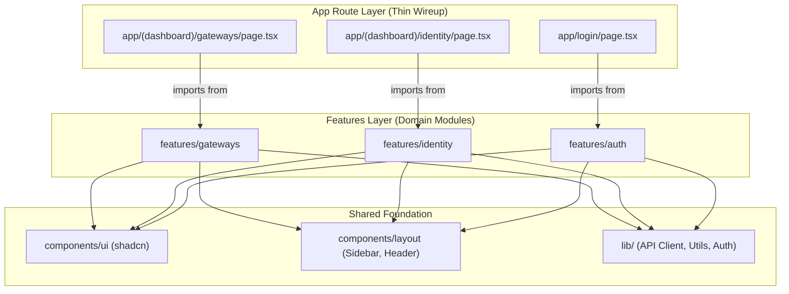

# Next.js Feature-Driven Modular Architecture (Screaming Architecture)

## 1. Core Philosophy

When building scalable Next.js applications, organizing files by technical type (`components/`, `hooks/`, `utils/`, `types/`) leads to fragmentation as the project grows. Instead, this codebase enforces **Feature-Driven Modular Architecture** (also known as Screaming Architecture or FSD-Lite).

- **Domain-first**: Code is grouped around business features (`features/gateways`, `features/identity`, `features/auth`, `features/telemetry`).
- **Thin Route Layer**: The Next.js `app/` folder contains only minimal routing wireup, layouts, metadata, and suspense boundaries.
- **Strict Public API**: Each feature exposes its public components, hooks, actions, and types strictly through its `index.ts`.
- **Dumb Atomic UI**: `components/ui/` contains only domain-agnostic primitive components (shadcn/ui base-lyra primitives).



---

## 2. Directory Structure Blueprint

```text
angkorgate-console/
├── app/                        # THIN ROUTE LAYER
│   ├── (auth)/
│   │   └── login/page.tsx      # Mounts <LoginForm /> from @/features/auth
│   ├── (dashboard)/
│   │   ├── layout.tsx          # Dashboard shell: SidebarProvider + Header + Inset
│   │   ├── dashboard/page.tsx  # Overview page
│   │   ├── gateways/page.tsx   # Gateway route & proxy management
│   │   └── identity/page.tsx   # OIDC client management
│   ├── api/                    # Route handlers (webhooks, healthz)
│   ├── layout.tsx              # Root HTML, ThemeProvider, TooltipProvider, Fonts
│   └── globals.css             # Claude Code theme tokens
│
├── features/                   # FEATURE MODULES (Domain Logic)
│   ├── auth/                   # Authentication & Session
│   │   ├── components/         # Feature UI (LoginForm.tsx, OAuthButtons.tsx)
│   │   ├── server/             # auth-actions.ts, session.ts ("server-only")
│   │   ├── types/              # auth.schemas.ts (Zod)
│   │   └── index.ts            # Public barrel export
│   ├── gateways/               # API Gateway Routes & Policies
│   │   ├── components/         # RouteTable.tsx, UpstreamCard.tsx, CreateRouteDialog.tsx
│   │   ├── server/             # gateway-actions.ts, gateway-queries.ts
│   │   ├── hooks/              # use-route-filter.ts
│   │   ├── types/              # route.types.ts, route.schemas.ts
│   │   └── index.ts
│   ├── identity/               # OpenID Connect Clients & Keys
│   │   ├── components/         # ClientList.tsx, SecretViewer.tsx
│   │   ├── server/             # oidc-actions.ts
│   │   ├── types/              # oidc.types.ts
│   │   └── index.ts
│   └── telemetry/              # Metrics, Latency & Logs
│       ├── components/         # MetricCard.tsx, LatencyChart.tsx
│       └── index.ts
│
├── components/                 # SHARED PRESENTATIONAL LAYER
│   ├── ui/                     # Pure shadcn primitives (button, card, dialog, badge)
│   ├── layout/                 # Shell: AppSidebar, SiteHeader, NavMain, NavUser
│   └── feedback/               # EmptyState, ErrorBoundary, ConfirmDialog
│
├── lib/                        # SHARED INFRASTRUCTURE
│   ├── api-client.ts           # Type-safe fetch client for angkorgate-core
│   ├── env.ts                  # Validated environment variables (Zod)
│   └── utils.ts                # cn helper, formatters, date helpers
│
└── types/                      # GLOBAL SHARED CONTRACTS
    └── index.ts                # Pagination, ApiResponse<T>, FilterParams
```

---

## 3. Mandatory Rules for Agents

### Rule 1: The Thin Route Principle
Pages in `app/**/page.tsx` must NOT contain large JSX blocks, form definitions, or business logic. 
A route page should only:
1. Handle searchParams / params.
2. Fetch data (Server Component) or delegate to a feature component.
3. Wrap in a Suspense boundary / Page shell.
4. Render the feature component.

**Example (`app/gateways/page.tsx`):**
```tsx
import { Suspense } from "react"
import { GatewayRouteList, GatewayRouteSkeleton } from "@/features/gateways"

export default function GatewaysPage() {
  return (
    <div className="flex flex-1 flex-col gap-6 p-6">
      <h1 className="font-heading text-2xl font-bold">API Routes</h1>
      <Suspense fallback={<GatewayRouteSkeleton />}>
        <GatewayRouteList />
      </Suspense>
    </div>
  )
}
```

### Rule 2: The Barrel Boundary (`features/<name>/index.ts`)
- Everything inside a feature is private by default.
- Only components, actions, hooks, and types explicitly exported in `features/<name>/index.ts` can be imported by other parts of the application.
- **Never** do deep imports such as `import { Form } from "@/features/auth/components/LoginForm"`.
- Always import via: `import { LoginForm } from "@/features/auth"`.

### Rule 3: Strict Server vs. Client Isolation
- Server actions and data-fetching modules MUST include `import "server-only"` at the very top.
- Client components MUST include `"use client"` at the very top and should remain at the leaves of the component tree.
- Do NOT make an entire page `"use client"` unless the entire route is purely interactive state. Prefer server components for data-fetching and pass data to client interactive elements as props.

### Rule 4: Single Source of Truth Validation (Zod Schemas)
Every form submission or API input must be backed by a Zod schema in `features/<name>/types/*.schemas.ts`:
```tsx
import { z } from "zod"

export const CreateRouteSchema = z.object({
  path: z.string().min(1, "Path is required").startsWith("/"),
  upstreamUrl: z.string().url("Must be a valid URL"),
  stripPrefix: z.boolean().default(true),
})

export type CreateRouteInput = z.infer<typeof CreateRouteSchema>
```

### Rule 5: Centralized API Client (`lib/api-client.ts`)
Never use raw `fetch("http://localhost:3000/...")` directly inside UI components. Always use the centralized `apiClient` instance in `lib/api-client.ts` to ensure automatic base URL resolution, authentication headers, error wrapping, and revalidation.

---

## 4. How to Add a New Feature (Step-by-Step)

When instructed to add a new domain capability (e.g. `audit-logs`):
1. **Create the module directory**:
   ```bash
   mkdir -p angkorgate-console/features/audit-logs/{components,server,types}
   ```
2. **Define data contracts & schemas**:
   `features/audit-logs/types/audit-log.schemas.ts`
3. **Implement server actions / queries**:
   `features/audit-logs/server/audit-log-queries.ts` (with `import "server-only"`)
4. **Build the feature components**:
   `features/audit-logs/components/AuditLogTable.tsx`
5. **Expose the public interface**:
   `features/audit-logs/index.ts`
6. **Mount in the route**:
   `app/(dashboard)/audit-logs/page.tsx`
7. **Verify**:
   `npm run typecheck && npm run build`
